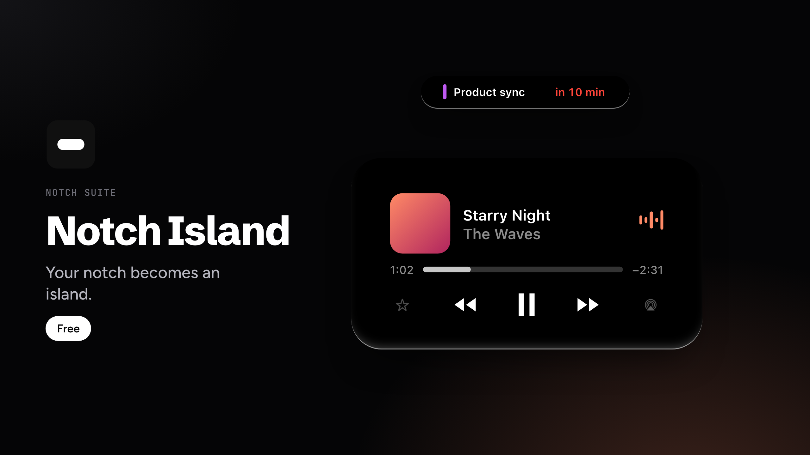

# Notch Island

Your notch becomes an island. The iPhone's Dynamic Island on your Mac: music, timers, voice memos, meetings and reminders drop down from the notch when you need them, then fade away. Free, with an optional one-time upgrade, [Notch Island Plus](https://eprysmn.gumroad.com/l/notchislandplus).

## Install

1. Download the DMG from the [latest release](../../releases/latest) and drag the app to Applications.
2. The app is not notarized by Apple. If macOS blocks the first launch, go to System Settings › Privacy & Security and click **Open Anyway**.

macOS 13 or later, Apple silicon or Intel.

The source code of Notch Island is not published here. This repository hosts the free downloads and release notes.

Part of Notch Suite: [Notch Island](https://github.com/eprysmn/notch-island), [Notch Bar](https://github.com/eprysmn/notch-bar) and [Notch Less](https://github.com/eprysmn/notch-less). Also on [Gumroad](https://eprysmn.gumroad.com).
